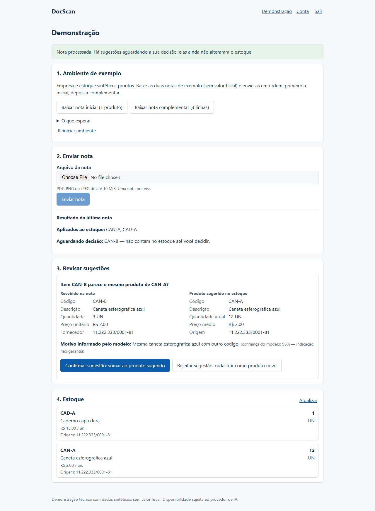
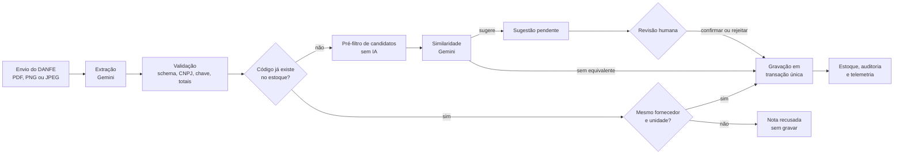

# DocScan

**Entrada de mercadorias a partir da nota fiscal, com IA que lê e uma pessoa que decide.**

O DocScan lê o DANFE (a versão impressa da nota fiscal eletrônica) em PDF ou imagem, confere os dados e lança os produtos no estoque. Quando um item parece ser um produto que já existe com outro código ou outro nome, o sistema mostra a sugestão e espera a confirmação de uma pessoa. A IA nunca altera o estoque sozinha.

**[Abrir a demonstração online](https://docscan-api-n5bj.onrender.com/app/)** · [Visão técnica](docs/portfolio-technical-overview.md) · [Roteiro da demonstração](docs/portfolio-demo-guide.md)



<sub>Tela de revisão com dados sintéticos (execução local). A nota já foi aplicada ao estoque, exceto o item que aguarda decisão.</sub>

---

## O problema

Quem recebe mercadoria confere a nota e digita cada item no sistema de estoque. É um trabalho repetitivo e sujeito a erro:

- **Digitação:** quantidade, preço ou código lançados errados.
- **Nomes diferentes para o mesmo produto:** o fornecedor chama de "Caneta esferográfica azul cód. 123" o que no estoque está como "Caneta azul". Sem cuidado, nasce um cadastro duplicado, ou dois produtos diferentes são somados como se fossem um.
- **Retrabalho:** a mesma nota lançada duas vezes, ou corrigir depois o que entrou errado.

## Como o DocScan resolve

1. **Lê a nota.** Você envia o PDF ou a foto do DANFE; a IA extrai fornecedor, itens, quantidades e valores.
2. **Confere antes de gravar.** Regras fixas validam o CNPJ, a chave de acesso e se a soma dos itens bate com o total da nota. Nota inconsistente é recusada, sem alterar nada.
3. **Reconhece o que já existe.** Mesmo código, do mesmo fornecedor e na mesma unidade, soma direto no produto. Quando o código não bate, a IA procura um produto parecido entre poucos candidatos e apenas **sugere**.
4. **Você decide.** A sugestão aparece lado a lado com o produto do estoque. Confirmar soma ao produto existente; rejeitar cria um produto novo. Até a decisão, o item não entra no estoque.
5. **Fica registrado.** Cada entrada e cada decisão ficam auditadas, e a mesma nota não é lançada duas vezes.

---

## Demonstração online

**Endereço:** <https://docscan-api-n5bj.onrender.com/app/>

O acesso é feito por **convite**: o cadastro pede um código de convite, que não é publicado neste repositório. Para pedir acesso, abra uma [issue neste repositório](https://github.com/WillGalvaoDev/node-invoice-reader/issues) informando como prefere ser contatado. O código é enviado em particular, nunca em comentário público.

Com o código em mãos:

1. Abra o endereço acima e clique em **Criar conta** (nome, e-mail, senha e código de convite).
2. Clique em **Preparar ambiente**: o sistema cria uma empresa e um estoque de exemplo, só seus.
3. Baixe a **nota inicial** e a **nota complementar** (documentos sintéticos, sem valor fiscal).
4. Envie a nota inicial e depois a complementar.
5. Revise a sugestão: **confirmar** soma ao produto existente; **rejeitar** cadastra um produto novo. Confira o estoque.
6. Para recomeçar, use **Reiniciar ambiente**.

Bom saber antes de usar:

- Use apenas as notas de exemplo. **Não envie notas fiscais reais.**
- O primeiro acesso depois de um período sem uso pode demorar mais que o normal enquanto o serviço inicia.
- A leitura usa o Google Gemini real. Se o provedor recusar ou demorar, a tela informa o erro e nada é gravado; basta tentar de novo mais tarde.
- O login tem limite de tentativas por endereço. Se aparecer aviso de limite, aguarde alguns minutos.

---

## Fluxo de funcionamento



Se qualquer etapa falhar (nota incoerente, IA indisponível, resposta fora do formato), a nota inteira é recusada e nada é gravado.

## Funcionalidades implementadas

- Leitura de DANFE em **PDF, PNG ou JPEG** (até 10 MiB), com conferência do tipo real do arquivo.
- Validação da extração: formato da resposta, CNPJ com dígitos verificadores, chave de 44 dígitos, soma dos itens contra o total e limite de itens por nota.
- Entrada automática no estoque quando código, fornecedor e unidade coincidem, com **custo médio ponderado**.
- Sugestões de produto equivalente por IA, com **confirmação ou rejeição humana**.
- Recusa explícita de conflitos (mesmo código de outro fornecedor ou em outra unidade), em vez de somar o que não é comparável.
- Bloqueio de nota repetida (mesma chave de acesso).
- Contas com login, troca de senha, empresas e estoques isolados por usuário.
- Interface web em `/app` e API HTTP documentada.
- Ambiente de demonstração por visitante, com notas sintéticas para baixar e reinício.
- Auditoria de entradas e decisões; telemetria de cada chamada à IA (tempo, tokens e falhas), sem conteúdo do documento.

## Aplicações práticas

Exemplos de uso do fluxo **já implementado** (leitura, conferência, sugestão e lançamento):

- **Papelaria ou loja de bairro:** lançar a nota do distribuidor sem digitar item por item, revisando apenas os produtos que chegaram com código ou nome diferente.
- **Pequeno comércio com vários fornecedores:** evitar que o mesmo código de dois fornecedores, ou unidades diferentes (`UN` e `CX`), sejam somados por engano.
- **Conferência de recebimento:** detectar notas cuja soma dos itens não bate com o total antes de qualquer lançamento.

Integração com ERP, emissão fiscal, leitura direta do XML da NF-e e catálogo de fornecedores **não existem** hoje; seriam evoluções futuras.

## Estado do projeto

**Demonstração funcional de portfólio, não um produto comercial pronto para operação.**

- Publicado no Render com banco PostgreSQL no Neon, sem SLA.
- O fluxo completo (cadastro, leitura com Gemini real, sugestão, confirmação, rejeição e persistência) foi validado manualmente no ambiente publicado.
- Os dados da demonstração são sintéticos. Não há backup com garantia de recuperação, recuperação de senha por e-mail nem suporte a notas reais.
- Histórico de decisões e evidências: [roadmap da demonstração](docs/demo-pilot-roadmap.md), [DP-04](docs/evidence/DP-04.md) e [DP-05](docs/evidence/DP-05.md).

---

# Para quem é técnico

## Arquitetura e stack

| Camada | Tecnologia | Responsabilidade |
|---|---|---|
| API | Node.js 24, TypeScript, Express 5 | rotas, autenticação, validação de entrada, limites de requisição |
| Interface | React 19, Vite, TypeScript | jornada da demonstração, servida pela própria API em `/app` (mesma origem, sem CORS) |
| IA | Google Gemini (`gemini-2.5-flash`, SDK `@google/genai`) | extração do documento e sugestão de similaridade |
| Validação | Zod | corpo das requisições e resposta estruturada do modelo |
| Dados | PostgreSQL, Prisma 7 (`@prisma/adapter-pg`) | persistência, migrations versionadas |
| Segurança | JWT (`jose`), Argon2, Helmet, `express-rate-limit` | sessão, senhas, cabeçalhos (CSP, HSTS), limites por IP e por usuário |
| Testes | Vitest, Testing Library, Playwright | unitários, integração com PostgreSQL real, E2E de navegador |
| Operação | GitHub Actions, Render, Neon | CI, deploy com migration no build, banco gerenciado |

Organização do código em `src/`:

- **`controllers/`**: tradução HTTP ↔ caso de uso, sem regra de negócio.
- **`use-cases/`**: orquestração (`ReadInvoiceUseCase`, decisões de sugestão, login, empresas).
- **`domain/`**: regras puras e determinísticas (CNPJ, coerência do DANFE), sem I/O.
- **`providers/`**: contratos para integrações externas (IA, armazenamento, hash, token).
- **`repositories/`** e **`mappers/`**: acesso a dados com Prisma e dublês em memória para testes; conversão explícita para tipos de domínio.
- **`middlewares/`**, **`schemas/`**, **`infra/`**, **`config/`**: autenticação, rate limit, Zod, logger, telemetria, configuração validada no boot.

Decisões deliberadas: sem container de injeção de dependência (composição manual em `src/routes.ts`); sem camada de entidades; artefatos compilados versionados junto do `.ts`, com guarda no CI (`verify:artifacts`). O contexto de cada decisão está em [`docs/auditoria-tecnica.md`](docs/auditoria-tecnica.md) e [`docs/backlog-engenharia.md`](docs/backlog-engenharia.md).

## Engenharia de IA

O modelo é tratado como **componente não confiável**: ele extrai e sugere; regras determinísticas e pessoas decidem.

| Etapa | Papel da IA | Controle determinístico |
|---|---|---|
| Extração | lê o documento e devolve JSON | schema Zod, tipos, limite de itens, CNPJ, chave de acesso, soma dos itens × total |
| Matching por código | nenhum | mesmo código só acumula com o mesmo fornecedor e a mesma unidade; conflito recusa a nota (`422`) |
| Similaridade | aponta um candidato **da lista oferecida** | pré-filtro léxico limita a 15 candidatos; ID fora da lista é recusado; limiar de confiança configurável |
| Alteração de identidade | nenhum | sugestão fica `PENDING` até confirmação ou rejeição humana |

- **Três resultados distintos de similaridade:** `match`, `no_match` e `unavailable`, modelados como união discriminada. Falha técnica do modelo (timeout, erro do provedor, JSON inválido, candidato inventado) é `unavailable`: a nota inteira é abortada com `503`, sem gravar nada, e pode ser reenviada. Indisponibilidade nunca vira "produto novo".
- **Conteúdo do documento é dado, não instrução:** texto dentro do PDF não altera o prompt de sistema.
- **Chamadas controladas:** timeout de 30 s, no máximo 2 tentativas para erros transitórios, nunca repetição em `429`.
- **Custo observado:** cada tentativa é reservada e reconciliada em um ledger, com tokens reais e custo estimado. Tetos diários existem, mas ficam desligados por padrão na demonstração; há um interruptor que desliga toda chamada de IA.

## Confiabilidade e segurança

- **Autenticação:** JWT com versão de sessão; trocar a senha invalida imediatamente os tokens anteriores. Senhas com Argon2. Cadastro por convite.
- **Isolamento:** autorização derivada do recurso, nunca do corpo da requisição. Recurso de outra conta responde como inexistente (`404`). Cada visitante da demonstração tem empresa e estoque próprios.
- **Transação única por nota:** produtos, sugestões e o registro da nota são gravados juntos ou não são gravados.
- **Idempotência:** a chave de acesso é única; reenvio responde `409` sem alterar o estoque.
- **Concorrência:** a regra fornecedor/unidade é revalidada dentro do `INSERT … ON CONFLICT … WHERE`; decisões de sugestão usam transição condicional, então uma decisão dupla é aplicada uma vez.
- **Upload seguro:** tamanho, tipo declarado e assinatura do arquivo conferidos; autorização antes de ler o arquivo.
- **Auditoria e observabilidade:** `AuditLog` de entradas, decisões e tentativas de acesso indevido; logs estruturados em JSON com redação de segredos e `X-Request-Id`; eventos de IA sem conteúdo do documento; `GET /version` expõe o SHA da release.
- **Operação:** healthcheck com consulta real ao banco, encerramento gracioso (`SIGTERM`), configuração validada no boot (falha rápida).

## Testes e CI

- **Unitários** (Vitest): regras de domínio, casos de uso, middlewares, provedor de IA com SDK substituído.
- **Integração com PostgreSQL real** (Docker): transações, rollback, concorrência, constraints, idempotência e isolamento entre contas.
- **E2E de navegador** (Playwright): jornada completa contra a API compilada, banco efêmero e um Gemini determinístico em processo separado.
- **CI** (GitHub Actions): validação do Prisma, typecheck, lint, build, guarda de artefatos, testes unitários e de integração, build de produção só com dependências de runtime, o comando exato de build do Render e o E2E.

## Executar localmente

Requisitos: Node.js 24 (`.nvmrc`), PostgreSQL e uma chave da API do Gemini. Docker é necessário apenas para os testes de integração e E2E.

```bash
npm ci
cp .env.example .env    # preencher DATABASE_URL, JWT_SECRET (>= 32 caracteres), GEMINI_API_KEY e INVITE_CODE (>= 8 caracteres)
npm run prisma:generate
npx prisma migrate deploy
npm run dev             # API em http://localhost:3333
```

Para usar a interface e as rotas da demonstração localmente:

```bash
npm run web:install && npm run web:build   # gera web/dist, servido em /app
# no .env: DEMO_ENABLED=true
npm run build && npm start                  # http://localhost:3333/app/
```

Verificações:

```bash
npm test                                   # unitários
npm run test:integration:postgres:docker   # integração (PostgreSQL efêmero via Docker)
npm run web:test                           # componentes da interface
npm run web:test:e2e                       # E2E (Docker e Chrome)
npm run typecheck && npm run lint && npm run build && npm run verify:artifacts
```

Os testes não chamam o Gemini real. `JWT_SECRET` pode ser gerado com `openssl rand -base64 48`.

## Limitações conhecidas

- **Identificação do visitante atrás do proxy do Render (D03):** o limite de tentativas de login usa o endereço de rede do visitante, e atrás da cadeia Cloudflare + balanceador do Render essa identificação não é estável. Na prática, visitantes podem dividir o mesmo limite, ou um visitante pode ter o limite dividido. Não permite falsificar a identidade; o efeito possível é um aviso de limite temporário. Detalhes em [DP-04](docs/evidence/DP-04.md) e no [runbook](docs/demo-operations-runbook.md) §10.
- **Dependências externas:** a disponibilidade depende do Google Gemini (sem cota reservada), do Render e do Neon. O primeiro acesso após um período sem uso pode ser mais lento.
- **Escopo do domínio:** sem catálogo de fornecedores nem conversão de unidades; o mesmo código de fornecedores ou unidades diferentes é recusado, não unificado. Produtos criados antes da migration `20261010220000_add_supplier_origin` têm origem desconhecida e recusam match exato.
- **Operação:** sem backup/restore com garantia de recuperação, sem recuperação de senha por e-mail, sem Dockerfile de produção. Rollback e encerramento gracioso foram ensaiados localmente, não no serviço publicado.
- A qualidade do matching foi observada em uma demonstração pequena; não há amostra para medir precisão.

---

# Referência

## API

Respostas no envelope `{ status: 'success', data }` ou `{ status: 'error', message }`.

| Método | Rota | Autenticação | Descrição |
|---|---|---|---|
| `GET` | `/health` | pública | `SELECT 1` real; sucesso em cache por 5 s; 60/IP/min; `503` com banco indisponível ou em shutdown. |
| `GET` | `/version` | pública | SHA da release da API e da interface. |
| `POST` | `/users` | pública, 5/hora por IP | Cadastro com `inviteCode`; ausente ou incorreto devolve o mesmo `403`. |
| `POST` | `/login` | pública, 10/15 min por IP | Devolve JWT. |
| `PATCH` | `/me/password` | JWT, 5/min por usuário | Troca a senha e invalida tokens anteriores (`204`). |
| `POST` | `/companies` | JWT, 5/min por usuário | Cria empresa e estoque principal na mesma transação. |
| `GET` | `/companies` | JWT | Empresas acessíveis, com papel (`OWNER`/`COLLABORATOR`), paginação por cursor. |
| `GET` | `/companies/:companyId/stocks` | JWT | Estoques visíveis; `404` sem distinguir inexistente de sem acesso. |
| `GET` | `/products` | JWT | Produtos por `stockId`, paginação por cursor. |
| `POST` | `/invoices/upload` | JWT, 5/min por usuário | Upload do DANFE e pipeline completo. `400`/`422` documento inválido ou conflito; `409` duplicata; `503` IA indisponível, sem gravar. |
| `GET` | `/stocks/:stockId/suggestions` | JWT | Sugestões pendentes. |
| `POST` | `/suggestions/:suggestionId/confirm` | JWT | Soma a entrada ao produto sugerido. |
| `POST` | `/suggestions/:suggestionId/reject` | JWT | Cadastra o item como produto novo. |
| `POST` | `/demo/sessions` | JWT, `DEMO_ENABLED=true` | Prepara ou reutiliza a sessão de demonstração (sem IA). |
| `GET` | `/demo/sessions/current` | JWT, `DEMO_ENABLED=true` | Sessão ativa ou `404`. |
| `GET` | `/demo/sessions/:sessionId/documents/:kind` | JWT, `DEMO_ENABLED=true` | PDF sintético (`initial` ou `followup`) com chave exclusiva da sessão. |
| `POST` | `/demo/sessions/:sessionId/restart` | JWT, `DEMO_ENABLED=true` | Arquiva a sessão e cria outra vazia (idempotente). |

## Variáveis de ambiente

Validadas no boot (`src/config/env.ts`); valor inválido impede a inicialização. Modelo em `.env.example`.

| Variável | Obrigatória | Default | Descrição |
|---|---|---|---|
| `DATABASE_URL` | sim | — | PostgreSQL. |
| `JWT_SECRET` | sim | — | Assinatura HS256; mínimo de 32 caracteres. |
| `GEMINI_API_KEY` | sim | — | Google Gemini. |
| `INVITE_CODE` | sim | — | Convite exigido no cadastro; mínimo de 8 caracteres; nunca versionado. |
| `PORT` | não | `3333` | Porta HTTP. |
| `TRUST_PROXY_HOPS` | não | `0` | Proxies confiáveis (0–10) no modo `hops`. Atrás de Cloudflare + Render, `1` identifica a borda do Cloudflare e `2` aceita valor forjado com cadeia incompleta; preferir `TRUST_PROXY_MODE`. |
| `TRUST_PROXY_MODE` | não | `hops` | `hops` ou `render-cloudflare` (exige `RENDER=true` e `TRUST_PROXY_HOPS` ausente/`0`). Ver runbook §10. |
| `CORS_ALLOWED_ORIGINS` | não | vazio | Allowlist HTTP(S) separada por vírgula; sem wildcard. |
| `REQUEST_TIMEOUT_MS` | não | `120000` | Timeout de requisição. |
| `SHUTDOWN_TIMEOUT_MS` | não | `30000` | Prazo do encerramento gracioso. |
| `GEMINI_TIMEOUT_MS` | não | `30000` | Timeout por tentativa ao Gemini. |
| `GEMINI_MAX_ATTEMPTS` | não | `2` | Tentativas (1–2) para erro transitório. |
| `SIMILARITY_CONFIDENCE_THRESHOLD` | não | `0.7` | Limiar de confiança da similaridade (0–1). |
| `DANFE_MAX_ITEMS` | não | `100` | Itens por nota (1–1000); acima disso, `422`. |
| `GEMINI_ENABLED` | não | `true` | `false` recusa toda chamada de IA com `503`. |
| `GEMINI_QUOTA_ENFORCEMENT_ENABLED` | não | `false` | Aplica tetos diários; a contabilização continua nos dois modos. |
| `GEMINI_GLOBAL_REQUESTS_PER_DAY` | não | `18` | Teto global (1–20), só com enforcement. |
| `GEMINI_USER_REQUESTS_PER_DAY` | não | `5` | Teto por usuário (1–20), só com enforcement. |
| `RELEASE_SHA` | não | — | SHA exibido em `/version` quando `RENDER_GIT_COMMIT` não existe. |
| `DEMO_ENABLED` | não | `false` | Registra as rotas `/demo/*`. |
| `DEMO_COMMANDS_PER_MINUTE` | não | `5` | Preparar/reiniciar sessão por usuário por minuto (1–60). |

## Deploy (Render + Neon)

- **Build:** `npm ci && npm run render:build` (Prisma generate, build da API e da interface, `prisma migrate deploy`). O mesmo comando roda no CI a partir de um checkout limpo.
- **Start:** `DATABASE_URL=$DATABASE_URL_POOLED npm start`. A migration usa a conexão direta do Neon; a aplicação usa a conexão com pooler.
- **Migrations seguem expand/contract:** rodam antes da nova versão entrar em tráfego e não são desfeitas por rollback, então toda migration precisa ser compatível com a versão anterior.
- Segredos (`JWT_SECRET`, `GEMINI_API_KEY`, `INVITE_CODE`) ficam só no painel do Render.

## Documentação

| Documento | Conteúdo |
|---|---|
| [Visão técnica](docs/portfolio-technical-overview.md) | resumo para apresentação: IA, integridade, custo e observabilidade |
| [Roteiro da demonstração](docs/portfolio-demo-guide.md) | passo a passo pela API e resultados esperados |
| [Especificação da demonstração](docs/portfolio-demo-spec.md) | escopo e decisões da demo |
| [Runbook operacional](docs/demo-operations-runbook.md) | publicação, smoke, rollback, proxy |
| [Runbook de telemetria](docs/telemetry-runbook.md) | consultas de chamadas, tokens, falhas e reconciliação |
| [Roadmap da demonstração](docs/demo-pilot-roadmap.md) | milestones DP-00 a DP-05 e evidências |
| [Auditoria técnica](docs/auditoria-tecnica.md) e [backlog](docs/backlog-engenharia.md) | histórico de decisões e plano de engenharia |
