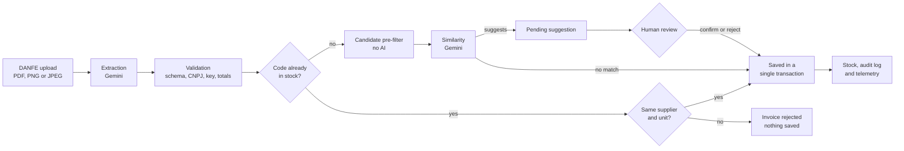

# DocScan

**English** | [Português (Brasil)](README.pt-BR.md)

**Goods receiving from the supplier invoice: AI reads it, a person decides.**

DocScan reads a DANFE (the printed version of a Brazilian electronic invoice, the NF-e) as a PDF or image, checks the data and records the products in stock. When an item looks like a product that already exists under a different code or name, the system shows the suggestion and waits for a person to confirm it. The AI never changes the stock on its own.

**[Open the live demo](https://docscan-api-n5bj.onrender.com/app/)** · [Technical overview](docs/portfolio-technical-overview.md) · [Demo walkthrough](docs/portfolio-demo-guide.md)

The application interface and the linked documents are in Portuguese.


<sub>Review screen with synthetic data (local run). The invoice has already been applied to stock, except for the item awaiting a decision.</sub>

---

## The problem

Whoever receives goods checks the invoice and types every item into the inventory system. It is repetitive work and error-prone:

- **Typing errors:** wrong quantity, price or product code.
- **Different names for the same product:** the supplier calls it "Blue ballpoint pen code 123" while the stock lists it as "Blue pen". Without care, a duplicate record is created, or two different products are added together as if they were one.
- **Rework:** the same invoice entered twice, or fixing afterwards what went in wrong.

## How DocScan solves it

1. **Reads the invoice.** You upload the PDF or a photo of the DANFE; the AI extracts the supplier, items, quantities and amounts.
2. **Checks before saving.** Fixed rules validate the CNPJ (the Brazilian company tax ID), the 44-digit access key and whether the item total matches the invoice total. An inconsistent invoice is rejected without changing anything.
3. **Recognizes what already exists.** The same code, from the same supplier and in the same unit, is added directly to the product. When the code does not match, the AI looks for a similar product among a few candidates and only **suggests** it.
4. **You decide.** The suggestion is shown side by side with the product in stock. Confirming adds to the existing product; rejecting creates a new product. Until you decide, the item does not enter the stock.
5. **Everything is recorded.** Every stock entry and every decision is audited, and the same invoice is never recorded twice.

---

## Live demo

**URL:** <https://docscan-api-n5bj.onrender.com/app/>

Access is by **invitation**: sign-up requires an invite code, which is not published in this repository. To request access, open an [issue in this repository](https://github.com/WillGalvaoDev/node-invoice-reader/issues) saying how you prefer to be contacted. The code is sent privately, never in a public comment.

Once you have the code (the interface is in Portuguese; button labels are shown as they appear):

1. Open the URL above and click **Criar conta** (create account: name, email, password and invite code).
2. Click **Preparar ambiente** (prepare environment): the system creates a sample company and stock that only you can see.
3. Download the **nota inicial** (initial invoice) and the **nota complementar** (follow-up invoice). Both are synthetic documents with no tax validity.
4. Upload the initial invoice, then the follow-up one.
5. Review the suggestion: **confirm** adds to the existing product; **reject** registers a new product. Check the stock.
6. To start over, use **Reiniciar ambiente** (restart environment).

Good to know before you start:

- Use only the sample invoices. **Do not upload real invoices.**
- The first visit after a period without use may take longer than usual while the service starts.
- Reading uses the real Google Gemini. If the provider refuses or times out, the screen shows the error and nothing is saved; just try again later.
- Login attempts are rate limited per network address. If you see a limit warning, wait a few minutes.

---

## How it works



If any step fails (inconsistent invoice, AI unavailable, response in the wrong format), the whole invoice is rejected and nothing is saved.

## Implemented features

- Reads DANFEs as **PDF, PNG or JPEG** (up to 10 MiB), checking the actual file type.
- Validates the extraction: response format, CNPJ check digits, 44-digit access key, item total against the invoice total, and a maximum number of items per invoice.
- Automatic stock entry when code, supplier and unit match, with **weighted average cost**.
- AI suggestions of equivalent products, with **human confirmation or rejection**.
- Explicit rejection of conflicts (same code from another supplier or in another unit) instead of adding up things that are not comparable.
- Blocks repeated invoices (same access key).
- User accounts with login and password change; companies and stocks isolated per user.
- Web interface at `/app` and a documented HTTP API.
- Per-visitor demo environment, with downloadable synthetic invoices and restart.
- Audit log of stock entries and decisions; telemetry for every AI call (time, tokens and failures), without document content.

## Practical applications

Examples of use for the flow that is **already implemented** (reading, checking, suggesting and recording):

- **Stationery or neighborhood store:** record the distributor's invoice without typing item by item, reviewing only the products that arrived with a different code or name.
- **Small business with several suppliers:** prevent the same code from two suppliers, or different units (`UN` and `CX`, unit and box), from being added together by mistake.
- **Receiving check:** catch invoices whose item total does not match the invoice total before anything is recorded.

Integration with ERP systems, tax document issuing, reading the NF-e XML file directly and a supplier catalog **do not exist** today; they would be future developments.

## Project status

**A working portfolio demo, not a commercial product ready for operation.**

- Deployed on Render with a PostgreSQL database on Neon, with no SLA.
- The full flow (sign-up, reading with the real Gemini, suggestion, confirmation, rejection and persistence) was validated manually in the deployed environment.
- Demo data is synthetic. There is no backup with guaranteed recovery, no password recovery by email and no support for real invoices.
- Decision history and evidence (in Portuguese): [demo roadmap](docs/demo-pilot-roadmap.md), [DP-04](docs/evidence/DP-04.md) and [DP-05](docs/evidence/DP-05.md).

---

# For technical readers

## Architecture and stack

| Layer | Technology | Responsibility |
|---|---|---|
| API | Node.js 24, TypeScript, Express 5 | routes, authentication, input validation, request limits |
| Interface | React 19, Vite, TypeScript | demo journey, served by the API itself at `/app` (same origin, no CORS) |
| AI | Google Gemini (`gemini-2.5-flash`, `@google/genai` SDK) | document extraction and similarity suggestions |
| Validation | Zod | request bodies and the model's structured response |
| Data | PostgreSQL, Prisma 7 (`@prisma/adapter-pg`) | persistence, versioned migrations |
| Security | JWT (`jose`), Argon2, Helmet, `express-rate-limit` | sessions, passwords, headers (CSP, HSTS), per-IP and per-user limits |
| Tests | Vitest, Testing Library, Playwright | unit, integration with real PostgreSQL, browser E2E |
| Operations | GitHub Actions, Render, Neon | CI, deploy with migration at build time, managed database |

Code organization in `src/`:

- **`controllers/`**: HTTP ↔ use case translation, no business rules.
- **`use-cases/`**: orchestration (`ReadInvoiceUseCase`, suggestion decisions, login, companies).
- **`domain/`**: pure, deterministic rules (CNPJ, DANFE consistency), no I/O.
- **`providers/`**: contracts for external integrations (AI, storage, hashing, tokens).
- **`repositories/`** and **`mappers/`**: data access with Prisma and in-memory test doubles; explicit conversion to domain types.
- **`middlewares/`**, **`schemas/`**, **`infra/`**, **`config/`**: authentication, rate limiting, Zod, logger, telemetry, configuration validated at boot.

Deliberate decisions: no dependency injection container (manual composition in `src/routes.ts`); no entity layer; compiled artifacts versioned next to the `.ts` files, guarded in CI (`verify:artifacts`). The context for each decision is in [`docs/auditoria-tecnica.md`](docs/auditoria-tecnica.md) and [`docs/backlog-engenharia.md`](docs/backlog-engenharia.md) (in Portuguese).

## AI engineering

The model is treated as an **untrusted component**: it extracts and suggests; deterministic rules and people decide.

| Step | Role of the AI | Deterministic control |
|---|---|---|
| Extraction | reads the document and returns JSON | Zod schema, types, item limit, CNPJ, access key, item total × invoice total |
| Code matching | none | the same code only accumulates with the same supplier and unit; a conflict rejects the invoice (`422`) |
| Similarity | points to a candidate **from the list provided** | lexical pre-filter limits it to 15 candidates; an ID outside the list is rejected; configurable confidence threshold |
| Identity change | none | the suggestion stays `PENDING` until a person confirms or rejects it |

- **Three distinct similarity outcomes:** `match`, `no_match` and `unavailable`, modeled as a discriminated union. A technical failure of the model (timeout, provider error, invalid JSON, made-up candidate) is `unavailable`: the whole invoice is aborted with `503`, nothing is saved, and it can be uploaded again. Unavailability never turns into "new product".
- **Document content is data, not instructions:** text inside the PDF does not change the system prompt.
- **Controlled calls:** 30 s timeout, at most 2 attempts for transient errors, never a retry on `429`.
- **Observed cost:** every attempt is reserved and reconciled in a ledger, with real token counts and an estimated cost. Daily caps exist but are off by default in the demo; a kill switch disables all AI calls.

## Reliability and security

- **Authentication:** JWT with a session version; changing the password immediately invalidates earlier tokens. Passwords hashed with Argon2. Sign-up by invitation.
- **Isolation:** authorization is derived from the resource, never from the request body. A resource belonging to another account responds as nonexistent (`404`). Each demo visitor has their own company and stock.
- **One transaction per invoice:** products, suggestions and the invoice record are saved together or not at all.
- **Idempotency:** the access key is unique; a repeated upload returns `409` without changing the stock.
- **Concurrency:** the supplier/unit rule is revalidated inside the `INSERT … ON CONFLICT … WHERE`; suggestion decisions use a conditional transition, so a double decision is applied only once.
- **Safe uploads:** size, declared type and file signature are checked; authorization happens before the file is read.
- **Audit and observability:** `AuditLog` of stock entries, decisions and unauthorized access attempts; structured JSON logs with secret redaction and `X-Request-Id`; AI events without document content; `GET /version` exposes the release SHA.
- **Operations:** health check with a real database query, graceful shutdown (`SIGTERM`), configuration validated at boot (fail fast).

## Tests and CI

- **Unit** (Vitest): domain rules, use cases, middlewares, AI provider with a substituted SDK.
- **Integration with real PostgreSQL** (Docker): transactions, rollback, concurrency, constraints, idempotency and isolation between accounts.
- **Browser E2E** (Playwright): full journey against the compiled API, an ephemeral database and a deterministic Gemini running in a separate process.
- **CI** (GitHub Actions): Prisma validation, typecheck, lint, build, artifact guard, unit and integration tests, production build with runtime dependencies only, the exact Render build command, and the E2E suite.

## Running locally

Requirements: Node.js 24 (`.nvmrc`), PostgreSQL and a Gemini API key. Docker is only needed for the integration and E2E tests.

```bash
npm ci
cp .env.example .env    # fill in DATABASE_URL, JWT_SECRET (>= 32 characters), GEMINI_API_KEY and INVITE_CODE (>= 8 characters)
npm run prisma:generate
npx prisma migrate deploy
npm run dev             # API at http://localhost:3333
```

To use the interface and the demo routes locally:

```bash
npm run web:install && npm run web:build   # builds web/dist, served at /app
# in .env: DEMO_ENABLED=true
npm run build && npm start                  # http://localhost:3333/app/
```

Checks:

```bash
npm test                                   # unit
npm run test:integration:postgres:docker   # integration (ephemeral PostgreSQL via Docker)
npm run web:test                           # interface components
npm run web:test:e2e                       # E2E (Docker and Chrome)
npm run typecheck && npm run lint && npm run build && npm run verify:artifacts
```

The tests do not call the real Gemini. `JWT_SECRET` can be generated with `openssl rand -base64 48`.

## Known limitations

- **Visitor identification behind the Render proxy (D03):** the login attempt limit uses the visitor's network address, and behind the Cloudflare + Render load balancer chain this identification is not stable. In practice, visitors may share the same limit, or one visitor's limit may be split. It does not allow identity spoofing; the possible effect is a temporary limit warning. Details in [DP-04](docs/evidence/DP-04.md) and in the [runbook](docs/demo-operations-runbook.md) §10.
- **External dependencies:** availability depends on Google Gemini (no reserved quota), Render and Neon. The first visit after a period without use may be slower.
- **Domain scope:** no supplier catalog and no unit conversion; the same code from different suppliers or units is rejected, not merged. Products created before the `20261010220000_add_supplier_origin` migration have an unknown origin and reject exact matches.
- **Operations:** no backup/restore with guaranteed recovery, no password recovery by email, no production Dockerfile. Rollback and graceful shutdown were rehearsed locally, not on the deployed service.
- Matching quality was observed in a small demo; there is no sample large enough to measure accuracy.

---

# Reference

## API

Responses use the envelope `{ status: 'success', data }` or `{ status: 'error', message }`.

| Method | Route | Authentication | Description |
|---|---|---|---|
| `GET` | `/health` | public | Real `SELECT 1`; success cached for 5 s; 60/IP/min; `503` when the database is unavailable or during shutdown. |
| `GET` | `/version` | public | Release SHA of the API and the interface. |
| `POST` | `/users` | public, 5/hour per IP | Sign-up with `inviteCode`; a missing or wrong code returns the same `403`. |
| `POST` | `/login` | public, 10/15 min per IP | Returns a JWT. |
| `PATCH` | `/me/password` | JWT, 5/min per user | Changes the password and invalidates earlier tokens (`204`). |
| `POST` | `/companies` | JWT, 5/min per user | Creates a company and its main stock in the same transaction. |
| `GET` | `/companies` | JWT | Accessible companies, with role (`OWNER`/`COLLABORATOR`), cursor pagination. |
| `GET` | `/companies/:companyId/stocks` | JWT | Visible stocks; `404` without distinguishing nonexistent from no access. |
| `GET` | `/products` | JWT | Products by `stockId`, cursor pagination. |
| `POST` | `/invoices/upload` | JWT, 5/min per user | DANFE upload and full pipeline. `400`/`422` invalid document or conflict; `409` duplicate; `503` AI unavailable, nothing saved. |
| `GET` | `/stocks/:stockId/suggestions` | JWT | Pending suggestions. |
| `POST` | `/suggestions/:suggestionId/confirm` | JWT | Adds the entry to the suggested product. |
| `POST` | `/suggestions/:suggestionId/reject` | JWT | Registers the item as a new product. |
| `POST` | `/demo/sessions` | JWT, `DEMO_ENABLED=true` | Prepares or reuses the demo session (no AI). |
| `GET` | `/demo/sessions/current` | JWT, `DEMO_ENABLED=true` | Active session or `404`. |
| `GET` | `/demo/sessions/:sessionId/documents/:kind` | JWT, `DEMO_ENABLED=true` | Synthetic PDF (`initial` or `followup`) with an access key unique to the session. |
| `POST` | `/demo/sessions/:sessionId/restart` | JWT, `DEMO_ENABLED=true` | Archives the session and creates an empty one (idempotent). |

## Environment variables

Validated at boot (`src/config/env.ts`); an invalid value prevents startup. Template in `.env.example`.

| Variable | Required | Default | Description |
|---|---|---|---|
| `DATABASE_URL` | yes | — | PostgreSQL. |
| `JWT_SECRET` | yes | — | HS256 signing key; at least 32 characters. |
| `GEMINI_API_KEY` | yes | — | Google Gemini. |
| `INVITE_CODE` | yes | — | Invite required at sign-up; at least 8 characters; never versioned. |
| `PORT` | no | `3333` | HTTP port. |
| `TRUST_PROXY_HOPS` | no | `0` | Trusted proxies (0–10) in `hops` mode. Behind Cloudflare + Render, `1` identifies the Cloudflare edge and `2` accepts a forged value when the chain is incomplete; prefer `TRUST_PROXY_MODE`. |
| `TRUST_PROXY_MODE` | no | `hops` | `hops` or `render-cloudflare` (requires `RENDER=true` and `TRUST_PROXY_HOPS` absent/`0`). See runbook §10. |
| `CORS_ALLOWED_ORIGINS` | no | empty | Comma-separated HTTP(S) allowlist; no wildcard. |
| `REQUEST_TIMEOUT_MS` | no | `120000` | Request timeout. |
| `SHUTDOWN_TIMEOUT_MS` | no | `30000` | Graceful shutdown deadline. |
| `GEMINI_TIMEOUT_MS` | no | `30000` | Timeout per Gemini attempt. |
| `GEMINI_MAX_ATTEMPTS` | no | `2` | Attempts (1–2) for transient errors. |
| `SIMILARITY_CONFIDENCE_THRESHOLD` | no | `0.7` | Similarity confidence threshold (0–1). |
| `DANFE_MAX_ITEMS` | no | `100` | Items per invoice (1–1000); above that, `422`. |
| `GEMINI_ENABLED` | no | `true` | `false` rejects every AI call with `503`. |
| `GEMINI_QUOTA_ENFORCEMENT_ENABLED` | no | `false` | Applies daily caps; usage accounting continues in both modes. |
| `GEMINI_GLOBAL_REQUESTS_PER_DAY` | no | `18` | Global cap (1–20), only with enforcement. |
| `GEMINI_USER_REQUESTS_PER_DAY` | no | `5` | Per-user cap (1–20), only with enforcement. |
| `RELEASE_SHA` | no | — | SHA shown at `/version` when `RENDER_GIT_COMMIT` is not set. |
| `DEMO_ENABLED` | no | `false` | Registers the `/demo/*` routes. |
| `DEMO_COMMANDS_PER_MINUTE` | no | `5` | Prepare/restart session commands per user per minute (1–60). |

## Deploy (Render + Neon)

- **Build:** `npm ci && npm run render:build` (Prisma generate, API and interface build, `prisma migrate deploy`). The same command runs in CI from a clean checkout.
- **Start:** `DATABASE_URL=$DATABASE_URL_POOLED npm start`. The migration uses Neon's direct connection; the application uses the pooled connection.
- **Migrations follow expand/contract:** they run before the new version takes traffic and are not undone by a rollback, so every migration must be compatible with the previous version.
- Secrets (`JWT_SECRET`, `GEMINI_API_KEY`, `INVITE_CODE`) live only in the Render dashboard.

## Documentation

All documents below are in Portuguese.

| Document | Content |
|---|---|
| [Technical overview](docs/portfolio-technical-overview.md) | presentation summary: AI, integrity, cost and observability |
| [Demo walkthrough](docs/portfolio-demo-guide.md) | step by step through the API and expected results |
| [Demo specification](docs/portfolio-demo-spec.md) | demo scope and decisions |
| [Operations runbook](docs/demo-operations-runbook.md) | deployment, smoke test, rollback, proxy |
| [Telemetry runbook](docs/telemetry-runbook.md) | queries for calls, tokens, failures and reconciliation |
| [Demo roadmap](docs/demo-pilot-roadmap.md) | milestones DP-00 to DP-05 and evidence |
| [Technical audit](docs/auditoria-tecnica.md) and [backlog](docs/backlog-engenharia.md) | decision history and engineering plan |
